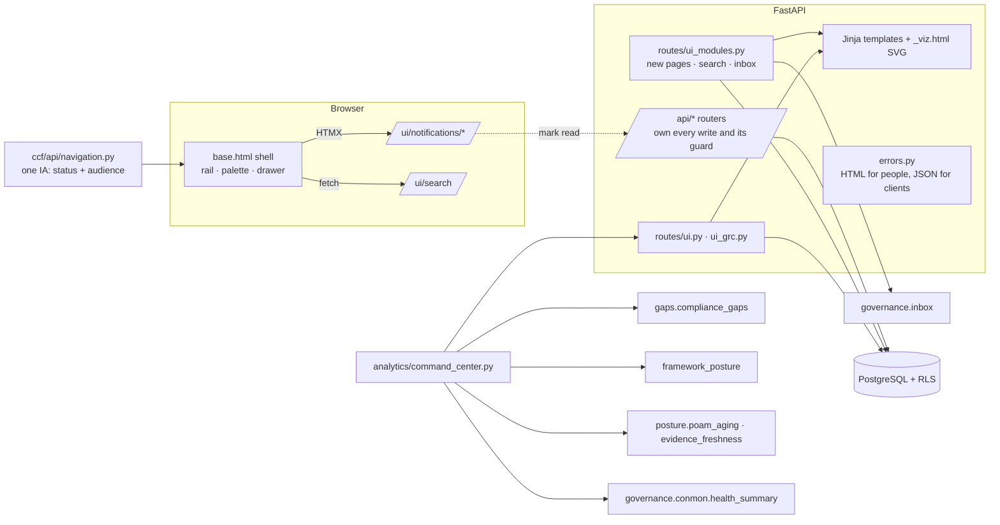

# Concord enterprise redesign — implementation report

Branch `feature/concord-enterprise-redesign`, cut from `fix/tier0-gate-bypasses`
at `cdfa107` (2026-10-20). Worked in a separate worktree
(`../CrossCtlFrameworks-redesign`) because another session was active in the
main checkout.

## 1. What was asked, and what was delivered

The brief asked for a full visual redesign, the 11-group navigation, an
executive command center on real data, modernised existing modules, a unified
GRC data model, new GRC modules, governed AI, a security review, tests,
deployment and rollback. Its own priority order put the visual redesign and
preservation of existing behaviour first.

**Delivered**

- Design system: dark (navy/cyan/violet) and light (slate/blue/violet) themes
  on the existing token contract; OS preference respected until the user
  chooses; contrast and chip distinctness measured by the test suite. See
  `docs/DESIGN.md`.
- Application shell: grouped, collapsible rail; breadcrumbs; command palette
  with org-scoped record search; notification center with per-user read state;
  keyboard shortcuts; error pages for people (JSON unchanged for clients);
  responsive to 390px; rail filtered by the same role gates as the routes.
- Navigation: all 70 requested items plus 18 existing Concord pages that had
  no slot in the brief (88 entries). Each is live, partial (with what is
  missing) or planned (an honest placeholder page). Inventory in §5.
- Executive command center at `/dashboard`, on recorded data only (§3).
- Eight new pages over models that had an API but no screen: My Tasks,
  Notifications, Risk Heat Map (with drill-down), Exceptions, Policies &
  Acknowledgments, Control Owners, Vendors, Approvals.
- The existing gaps view moved to `/gaps` unchanged; links and the connector
  redirect follow it.

**Not delivered** (each is a schema or product decision, not a styling task —
see §7): a 5×5 risk scale, posture history for compliance trends, business
units, governance committees, strategic objectives, KRIs/appetite, audit
workpapers, contract obligations, compensating-control records, risk
forecasting, an AI analysis page, OSCAL/SSP generation changes, RBAC beyond
the four fixed roles.

## 2. Discovery

- **Stack**: FastAPI + Jinja2 + HTMX + Alpine, hand-authored CSS with no build
  step, PostgreSQL (pgvector image) with row-level security, Alembic, Docker
  Compose. Verified, not assumed.
- **Port 8088** is `ccf-api` (compose project `ccf`, rooted at the main
  checkout). Nothing else is bound to it.
- **The running app was 18 days stale**: image built 2026-10-02 at commit
  `657c6d1`; the dev database at migration `0092` while the code base is at
  `0098`.
- **Shared infrastructure**: `ccf-test-db` (5434) is shared with other
  sessions, so this work used its own test database `ccf_test_redesign`;
  `cypher-pg-test` and `arc_postgres` belong to other projects and were not
  touched. No Carbon or Fabric service is connected to Concord's compose stack.
- **Secrets**: the dev stack runs on compose's development defaults (no
  `.env`), so a rebuild from a clean environment reproduces them exactly.
- **Inventory**: 69 templates and ~60 HTML routes before the change; the
  route-by-route mapping to the requested navigation is §5.

## 3. The command center, and what it refuses to show

Every figure is an existing analytic or a count over dated rows
(`ccf/analytics/command_center.py`), and every KPI carries the sentence that
says what it is over (shown on hover).

| Mockup element | What ships | Why it differs |
|---|---|---|
| "Compliance score 87%" | **Controls passing** — passing ÷ assessed, labelled "of assessed controls" | Concord deliberately refuses a cross-framework score (`org_framework_posture`). On the real data the two differ tenfold: 71% of *assessed* controls pass, but 2% (800-53 Moderate) and 6% (800-171) of the *declared baselines* are addressed. Both are on the page, each with its denominator. |
| 5×5 risk heat map | 3×3 likelihood × impact | `Risk` records three levels. Two of five rows would be empty by construction and read as "no risk at that likelihood". |
| Risk trends over 6 months | POA&M opened vs closed per month; control-test runs per week by outcome | SPRS, framework posture, implementation status and risk scores are overwritten in place. No history exists to draw. The panel names what is not trended. |
| Framework bars for CSF 2.0, ISO 27001, SOC 2, CIS | "Mapping only" | Crosswalks exist; Concord does not measure posture against them, so no percentage is invented. |
| Audit readiness 92% | Evidence requests accepted ÷ requests on open engagements | The checkable thing Concord records. `—` when there are none. |

A ratio over an empty set renders `—`, never 0% or 100%
(`command_center.ratio`, unit-tested).

## 4. Architecture



New pages read; writes stay on the API routes that already own their guards
(approvals' separation of duties, policy attestation, waivers, notification
read-state).

## 5. Feature inventory

Generated from `ccf/api/navigation.py`, the same data the rail renders, so it cannot drift from what users see. "Live (new page)" marks pages added by this work.

| Group | Item | Status | Where | What is missing |
|---|---|---|---|---|
| Command Center | Executive Dashboard | Live (new page) | `/dashboard` |  |
| Command Center | Compliance Posture | Live | `/posture` |  |
| Command Center | Security & Risk Intelligence | Partial | `/operations` | Vulnerability response, SLA, MTTR and risk bands. No external threat-intelligence feed. |
| Command Center | My Tasks | Live (new page) | `/my-tasks` |  |
| Command Center | Notifications | Live (new page) | `/notifications` |  |
| Command Center | Guided Workspace | Live | `/workspace` |  |
| Governance | Organization & Business Units | Planned | `/planned/org_units` | Organizations can be created (on Assets & Systems) but not edited, and there is no business-unit model. |
| Governance | Policies & Procedures | Live (new page) | `/policies` |  |
| Governance | Governance Committees | Planned | `/planned/committees` | No committee, charter or meeting-record model exists. |
| Governance | Strategic Objectives | Planned | `/planned/objectives` | No objective model exists, and nothing links risks or controls to one. |
| Governance | Exception Management | Live (new page) | `/exceptions` |  |
| Governance | Policy Acknowledgments | Live (new page) | `/policies#acknowledgments` |  |
| Governance | People & Access Reviews | Live | `/personnel` |  |
| Governance | AI Governance | Live | `/ai-agents` |  |
| Risk Management | Enterprise Risk Register | Live | `/risks` |  |
| Risk Management | Cybersecurity Risk Register | Partial | `/risks` | One register; risks carry a free-text category, not a separate cyber register. |
| Risk Management | Risk Assessments | Partial | `/risks` | Likelihood, impact, inherent and residual scores live on the risk itself; there is no separate assessment record. |
| Risk Management | Risk Heat Maps | Live (new page) | `/risks/heatmap` |  |
| Risk Management | Risk Treatment Plans | Partial | `/poams` | Treatment is one field on the risk; action plans are tracked as POA&Ms. |
| Risk Management | Risk Appetite & KRIs | Planned | `/planned/kri` | No appetite statement, tolerance threshold or key-risk-indicator model exists. |
| Risk Management | Risk Acceptance | Live (new page) | `/exceptions#risk` |  |
| Compliance | Framework Library | Live | `/frameworks` |  |
| Compliance | Regulatory Requirements | Partial | `/regulatory` | A register of regulatory change. Requirements themselves come from the framework catalog. |
| Compliance | Compliance Obligations | Partial | `/fedramp20x` | Only FedRAMP obligations (KSIs and rules) are modelled. |
| Compliance | Cross-Framework Mapping | Live | `/mappings` |  |
| Compliance | Compliance Assessments | Live | `/assessments` |  |
| Compliance | Continuous Monitoring | Live | `/governance` |  |
| Compliance | Gap Analysis | Live (new page) | `/gaps` |  |
| Compliance | Mapping Coverage | Live | `/coverage` |  |
| Authorization | Systems & Boundaries | Live | `/systems` |  |
| Authorization | System Intake | Live | `/intake` |  |
| Authorization | SSP Builder | Live | `/ssp` |  |
| Authorization | CMMC / 800-171 Scoring | Live | `/scoring` |  |
| Authorization | Assurance Graph | Live | `/assurance` |  |
| Authorization | Compliance Graph | Live | `/graph` |  |
| Control Management | Unified Control Library | Live | `/controls` |  |
| Control Management | Control Implementations | Partial | `/systems` | Implementations are shown per system (system detail, SSP); there is no cross-system list. |
| Control Management | Control Testing | Live | `/control-tests` |  |
| Control Management | Control Effectiveness | Partial | `/control-tests` | Pass/fail metrics from control tests; there is no effectiveness rating. |
| Control Management | Control Owners | Live (new page) | `/control-owners` |  |
| Control Management | Control Inheritance | Partial | `/systems` | Inherited status shows per system; there is no inheritance management page. |
| Control Management | Compensating Controls | Planned | `/planned/compensating` | No compensating-control record links a substitute to the control it covers. |
| Audit & Assurance | Audit Planning | Live | `/audit-workspace` |  |
| Audit & Assurance | Audit Workpapers | Planned | `/planned/workpapers` | No workpaper model. Evidence requests (PBC) exist inside each engagement. |
| Audit & Assurance | Audit Findings | Partial | `/audit-workspace` | Findings are recorded per engagement; there is no cross-engagement list. |
| Audit & Assurance | Corrective Action Plans | Live | `/poams` |  |
| Audit & Assurance | Audit Readiness | Partial | `/operations` | FedRAMP 20x readiness is computed per system; there is no general readiness score. |
| Audit & Assurance | Auditor Portal | Live | `/admin/portal` |  |
| Audit & Assurance | Trust Center | Live | `/trust` |  |
| Evidence | Evidence Repository | Live | `/evidence` |  |
| Evidence | Evidence Requests | Partial | `/audit-workspace` | Requests (PBC) exist only inside an audit engagement. |
| Evidence | Collection Automation | Live | `/connectors` |  |
| Evidence | Evidence-to-Control Mapping | Partial | `/evidence` | Each evidence object names its control; there is no mapping view. |
| Evidence | Evidence Expiration | Partial | `/queries?key=expired-evidence&run=1` | Expired and stale evidence queries; no expiry workflow page. |
| Evidence | Evidence Packages | Planned | `/planned/evidence_pkg` | Authorization packages exist in the API and are shared from the Auditor Portal, but have no page of their own. |
| Evidence | Scan Ingestion | Live | `/scans` |  |
| Evidence | Workbook Ingestions | Live | `/ingestions` |  |
| Third-Party Risk | Vendor Inventory | Live (new page) | `/vendors` |  |
| Third-Party Risk | Vendor Assessments | Live | `/vendor-questionnaires` |  |
| Third-Party Risk | Vendor Risk Scores | Partial | `/vendors` | A rating per vendor and a score per questionnaire; no composite scoring model. |
| Third-Party Risk | Due Diligence | Planned | `/planned/due_diligence` | Nothing beyond questionnaires: no document checklist or onboarding review. |
| Third-Party Risk | Vendor Findings | Partial | `/vendor-questionnaires` | A questionnaire review can open a task per gap; there is no findings model. |
| Third-Party Risk | Contract Obligations | Planned | `/planned/contracts` | No contract or obligation model exists. |
| Operations | Remediation Workflows | Partial | `/poams?status=open` | POA&Ms and milestones. Remediation plans and patch campaigns are API-only. |
| Operations | Issues & Exceptions | Partial | `/exceptions` | Exceptions are unified; issues remain split across POA&Ms, gaps and findings. |
| Operations | Projects & Action Plans | Partial | `/poams` | Action plans are POA&Ms with milestones; there is no project model. |
| Operations | Scheduled Assessments | Planned | `/planned/scheduled` | Implementations carry a ConMon frequency and next-due date, but nothing renders a schedule. |
| Operations | Approval Workflows | Live (new page) | `/approvals` |  |
| Intelligence | Analytics Studio | Partial | `/queries` | Six fixed assurance queries; no ad-hoc query builder. |
| Intelligence | Executive Reporting | Live | `/executive` |  |
| Intelligence | Compliance Trends | Planned | `/planned/trends` | Concord does not keep posture history: SPRS, framework posture and implementation status are overwritten in place, so no honest trend can be drawn for them. The command center trends only what is recorded with a date. |
| Intelligence | Risk Forecasting | Planned | `/planned/forecast` | No forecasting model, and no risk history to forecast from. |
| Intelligence | AI-Assisted Analysis | Planned | `/planned/ai_analysis` | Governed AI actions exist in the API (/api/ai-actions) with review and audit; there is no analysis page yet. |
| Intelligence | Report Builder | Live | `/reports` |  |
| Platform Administration | Users, Teams & Roles | Live | `/users` |  |
| Platform Administration | RBAC & Permissions | Planned | `/planned/rbac` | Four fixed roles (admin, control owner, assessor, viewer). IdP group-to-role mappings are API-only; there is no permission model. |
| Platform Administration | Organization Settings | Live | `/settings` |  |
| Platform Administration | Framework Administration | Live | `/packs` |  |
| Platform Administration | Catalog Integrity | Live | `/catalog/integrity` |  |
| Platform Administration | Source Workbooks | Live | `/worksheets` |  |
| Platform Administration | Workbook Diff | Live | `/diff` |  |
| Platform Administration | Catalog Search | Live | `/search` |  |
| Platform Administration | Integrations | Partial | `/connectors` | Connectors have pages; webhooks, IdP and issue-tracker push are API-only. |
| Platform Administration | AI Providers | Live | `/admin/ai-settings` |  |
| Platform Administration | API Management | Partial | `/docs` | Interactive API reference only; tokens are issued by CLI, not managed here. |
| Platform Administration | Audit Logs | Live | `/audit` |  |
| Platform Administration | System Health | Live | `/admin/reliability` |  |
| Platform Administration | Self-Assurance | Live | `/admin/self-assurance` |  |

88 entries: 52 live, 22 partial, 14 planned.

## 6. Security

- **Tenant isolation is asserted where RLS cannot hide it.** Every new page and
  the record search are tested on an RLS-bypass session. Through the normal
  session, RLS filtered the rows anyway and four deleted org predicates
  survived the tests; after the change each org predicate in the new code was
  deleted once and a test failed.
- **The rail never offers a page the role cannot open.** Item audiences mirror
  `require_role` / `require_platform_admin`; a test drives every rail page per
  role through the real auth gate and requires "hidden" and "403" to coincide.
  Server-side gates remain the control.
- **No new write path.** Read-state changes go through the existing
  `/api/notifications` routes already on the viewer allowlist.
- **Palette links** are restricted to same-origin paths, and every
  record-derived string is escaped before it reaches `innerHTML`.
- **Error pages** preserve status codes and headers, and never apply to
  `/api` or `/static`.
- **Found, not fixed (defence in depth, not exploitable today):** `/reports`
  selects every organization and system with no org predicate; RLS hides other
  tenants' rows in the running app (verified in the browser).
- **Not re-verified here:** the policy API defects recorded on 2026-10-20
  (`add_version` without an org check; `attest` trusting a body `user_id`)
  belong to the policy-documents work on another branch. The new Policies page
  only reads; it does not call those routes.

- **Fixed on the way: `/poams` disagreed with every other page.** The
  register counted a soft-deleted system's POA&Ms: 41 open where the command
  center and posture said 37 for the same organization. It now uses the same
  live-systems definition (`posture.org_system_subq`); the test fails without
  the fix.

- **A policy decision, recorded rather than changed:** with no organization in
  scope (auth disabled, or a platform-wide principal), the new list pages show
  every tenant's rows, as the existing `/risks`, `/users` and `/poams` pages
  always have; the command center instead refuses to aggregate, because it
  computes one organization's posture. The notification inbox (`inbox.py`,
  unchanged) likewise shows a global principal every organization's
  broadcasts. Making list pages refuse too is a product decision for the
  platform-admin experience.

## 7. Remaining gaps, in dependency order

1. **Posture history** (a snapshot table written by the scheduler) — unlocks
   compliance trends, risk exposure over time and forecasting honestly.
2. **5-point likelihood/impact** — a migration that keeps today's 1/3/5 values,
   plus a rescoring rule; only then a 5×5 map.
3. **Organization structure** — business units, committees, objectives.
4. **Audit workpapers** and cross-engagement findings.
5. **Third-party depth** — contracts, obligations, due-diligence checklists.
6. **Governed AI analysis page** over `/api/ai-actions` (the API, review and
   audit trail already exist).
7. **RBAC** beyond four roles, and an API-token management page.

## 8. Deployment and rollback

Deploy uses the existing method (Docker Compose, project `ccf`), building from
the worktree. Both `api` and `migrator` are rebuilt — building `api` alone
leaves the migrator on the old image and the migration silently never runs.

```bash
W=/Users/kevinwhite/CrossCtlFrameworks-redesign
DC="env -i PATH=$PATH HOME=$HOME docker compose -p ccf --project-directory $W -f $W/docker-compose.yml --profile prep --profile assessment"

# 0. rollback points
for s in api migrator prep-worker assessment-worker; do docker tag "ccf-${s}:latest" "ccf-${s}:pre-redesign"; done
docker exec ccf-db pg_dump -U ccf -d ccf -Fc -Z 9 > ~/CrossCtlFrameworks-backups/ccf-dev-pre-deploy-$(date +%Y%m%dT%H%M).dump

# 1. build, migrate, recreate
$DC build api migrator prep-worker assessment-worker
$DC up migrator                       # 0092 -> 0098
$DC up -d --no-deps api prep-worker assessment-worker

# 2. verify
docker exec ccf-db psql -U ccf -d ccf -tAc "select version_num from ccf.alembic_version"
curl -fsS http://localhost:8088/healthz && curl -s -o /dev/null -w '%{http_code}\n' http://localhost:8088/dashboard
```

**Rollback** (application and data):

```bash
for s in api migrator prep-worker assessment-worker; do docker tag "ccf-${s}:pre-redesign" "ccf-${s}:latest"; done
docker stop ccf-api ccf-prep-worker ccf-assessment-worker
docker exec ccf-db psql -U ccf -d postgres -c "SELECT pg_terminate_backend(pid) FROM pg_stat_activity WHERE datname='ccf' AND pid <> pg_backend_pid();"
docker exec ccf-db psql -U ccf -d postgres -c "DROP DATABASE ccf;" -c "CREATE DATABASE ccf OWNER ccf;"
docker exec -i ccf-db pg_restore -U ccf -d ccf --no-owner < ~/CrossCtlFrameworks-backups/<the pre-deploy dump>
cd /Users/kevinwhite/CrossCtlFrameworks && docker compose up -d --no-build api prep-worker assessment-worker
```

The data rollback discards anything written after the deploy; it is only
needed if the old code cannot run on the migrated schema (`0098` drops the
assurance-edge confidence column). The code rollback alone is the tag swap.
Migrations `0093`–`0098` come from the base branch, not this one; this branch
adds no migration. `0097` deletes digest alerts stored without an
organization.


## 9. Verification

| Check | Result |
|---|---|
| Full test suite (own database `ccf_test_redesign`) | **5,396 passed, 2 skipped, 0 failed** in 14m02s at the final commit `6990b99` (after the review fixes); earlier 5,386 / 0 at `f89a352`. The two skips predate this work (no Python Playwright installed; a GCP test skipped by design). |
| Affected tests after the final fixes | 204 + 47 passed (shell, chips, new pages, deleted-system sweeps, POA&M pages) |
| New tests | `tests/test_command_center_and_modules.py`: empty-ratio rule, org-scoped service on an unscoped session, every new page both ways for isolation, heat-map drill-down, scoped search, unread badge, navigation resolves, every gap labelled, planned pages, rail-vs-gate per role, error-page negotiation, the `/poams` fix |
| Mutation checks | Each org predicate in the new code deleted once: every deletion failed a test (after the RLS-bypass session was introduced; before it, four survived) |
| Browser sweep | 74 pages × dark/light × 1440/390 px: status, console errors, horizontal overflow, text contrast against its effective background. Findings fixed: five phone-width overflows, one 4.35:1 link, a nested `<main>`, a 403 that showed raw JSON |
| Interactions driven in a real browser | ⌘K palette and record search, arrow keys and Esc, notification drawer and mark-read (badge 21→20), rail collapse persisted, `g r` jump, focus tooltips |
| Theme | Node harness runs the shipped `app.js`: OS dark/light with no choice, stored choice beats OS, toggle persists, "system" forgets, unreadable storage follows OS |


## 10. Independent review

A whole-branch review (separate agent, code read only) after the per-step
work found no tenant-to-tenant leak and no XSS path, and found two High and
six Medium defects, all now fixed with a test that fails without each fix
(`9801729`):

| Severity | Finding | Fix |
|---|---|---|
| High | "Controls passing" divided by every assessed control, including not-applicable and not-yet-run tests | Denominator is controls with a result; its parts now sum to it |
| High | ConMon health counted soft-deleted systems (command center and `/governance`) | `health_summary` scoped to live systems |
| Medium | Workspace failing-control chips still linked to `/dashboard` | Link to `/gaps` |
| Medium | Exceptions counted requested and revoked waivers, open and closed KSI exceptions | Count only exceptions in force; pending listed apart |
| Medium | Overdue KPI linked to a per-user page | Links to the org-wide register; basis states the due-date fallback |
| Medium | "Latest week" effectiveness could be stale or one run | Shows the week and run count |
| Medium | Old overdue dates crowded out every future milestone | 30-day lookback; older misses counted |
| Medium | 800-53 and FedRAMP drawn as two identical rows; a High baseline hid a Moderate one | One row per declared baseline, pairs merged, qualifier visible |
| Low | Charts with a maximum of 1, 10, 100 drew at half height; "5 of 3" acknowledgments; a palette response race; raw 422 JSON in the browser; AI Providers offered to principals it refuses | All fixed |

Redeployed after the fixes; signed-in screenshots in the published report are
from that build.
